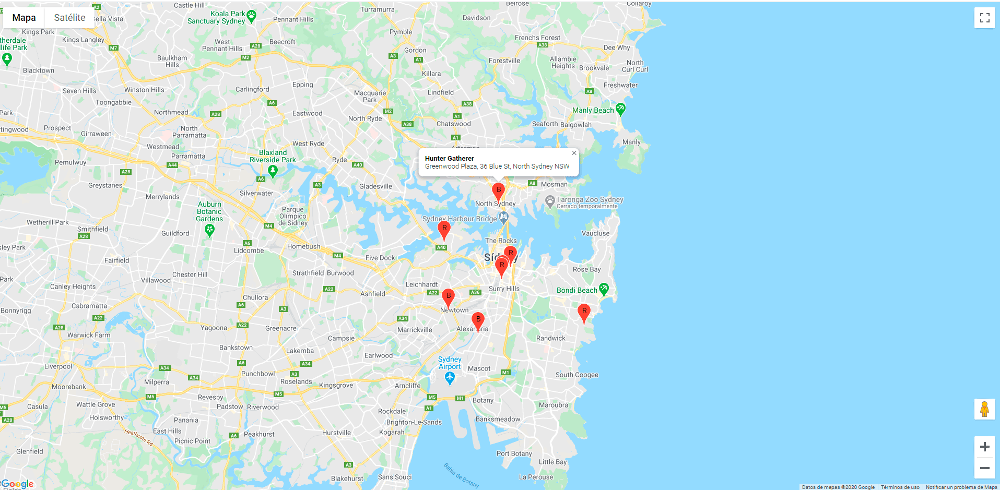
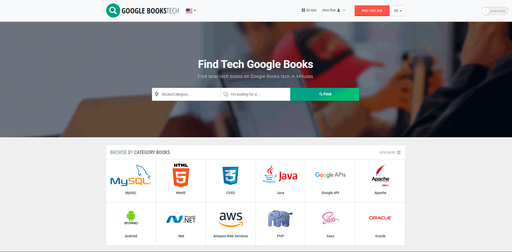

# PHP Google API — Ejemplos de Integración

Colección de ejemplos prácticos de integración con las **APIs de Google** desde PHP. El repositorio incluye implementaciones funcionales de **Google Maps** con almacenamiento de marcadores en MySQL y **Google Books** con autenticación OAuth 2.0, búsqueda de libros y visor integrado.

[](https://www.php.net/)
[](https://developers.google.com/maps)
[](https://developers.google.com/books)
[](https://www.mysql.com/)
[](https://developers.google.com/identity/protocols/oauth2)

---

## Tabla de Contenidos

- [Sobre el Proyecto](#sobre-el-proyecto)
- [Ejemplos Incluidos](#ejemplos-incluidos)
  - [Google Maps + MySQL](#1-google-maps--mysql)
  - [Google Books + OAuth](#2-google-books--oauth)
- [Arquitectura de las APIs de Google](#arquitectura-de-las-apis-de-google)
- [Estructura del Proyecto](#estructura-del-proyecto)
- [Tecnologías](#tecnologías)
- [Requisitos](#requisitos)
- [Instalación](#instalación)
- [Recursos](#recursos)
- [Autor](#autor)

---

## Sobre el Proyecto

Las APIs de Google ofrecen acceso a un ecosistema enorme de servicios (Maps, Books, YouTube, Drive, Calendar, etc.). Sin embargo, cada API tiene su propio sistema de autenticación, endpoints y modelos de datos. Este repositorio proporciona ejemplos claros y funcionales de cómo integrar dos de las APIs más utilizadas:

- **Google Maps API** — con API Key y almacenamiento de coordenadas en base de datos
- **Google Books API** — con OAuth 2.0 para acceso autenticado, búsquedas y visor de libros

Ambos ejemplos son independientes y autocontenidos, ideales como punto de partida para proyectos reales.

---

## Ejemplos Incluidos

### 1. Google Maps + MySQL

| | |
|---|---|
| **Carpeta** | `php-google-maps-mysql/` |
| **API** | [Google Maps JavaScript API](https://developers.google.com/maps/documentation/javascript) |
| **Autenticación** | API Key |
| **Base de datos** | MySQL (almacenamiento de marcadores/ubicaciones) |



#### Descripción

Aplicación que integra **Google Maps** con una base de datos **MySQL** para gestionar ubicaciones geográficas. Los marcadores se almacenan en la base de datos con sus coordenadas (latitud, longitud) y se renderizan dinámicamente sobre el mapa.

#### Funcionalidades

- Renderizado de mapa interactivo con Google Maps JavaScript API
- Marcadores dinámicos cargados desde MySQL
- Almacenamiento de ubicaciones con coordenadas (lat/lng) en base de datos
- Geocodificación: conversión entre direcciones y coordenadas
- InfoWindows con información detallada de cada marcador
- Interacción bidireccional: mapa ↔ base de datos

#### Flujo de Datos

```
┌──────────────┐     API Key       ┌──────────────────────┐
│              │ ────────────────►  │                      │
│   Frontend   │                   │  Google Maps JS API   │
│  (JavaScript)│ ◄────────────────  │                      │
│              │   Mapa + Tiles    │                      │
└──────┬───────┘                   └──────────────────────┘
       │
       │  AJAX (JSON)
       ▼
┌──────────────┐                   ┌──────────────────────┐
│              │     SQL Queries   │                      │
│   Backend    │ ────────────────► │      MySQL           │
│    (PHP)     │ ◄──────────────── │   (lat, lng, info)   │
│              │    Resultados     │                      │
└──────────────┘                   └──────────────────────┘
```

#### Ejemplo de Uso

```php
// Conexión a MySQL
$pdo = new PDO('mysql:host=localhost;dbname=google_maps', 'root', 'password');

// Obtener marcadores de la base de datos
$stmt = $pdo->query("SELECT id, name, lat, lng, description FROM markers");
$markers = $stmt->fetchAll(PDO::FETCH_ASSOC);

// Enviar al frontend como JSON
header('Content-Type: application/json');
echo json_encode($markers);
```

```javascript
// Inicializar mapa y cargar marcadores desde PHP/MySQL
function initMap() {
    const map = new google.maps.Map(document.getElementById('map'), {
        center: { lat: 41.3851, lng: 2.1734 }, // Barcelona
        zoom: 12
    });

    // Cargar marcadores desde el backend
    fetch('get_markers.php')
        .then(response => response.json())
        .then(markers => {
            markers.forEach(m => {
                new google.maps.Marker({
                    position: { lat: parseFloat(m.lat), lng: parseFloat(m.lng) },
                    map: map,
                    title: m.name
                });
            });
        });
}
```

---

### 2. Google Books + OAuth

| | |
|---|---|
| **Carpeta** | `php-google-books/` |
| **API** | [Google Books API v1](https://developers.google.com/books) |
| **Autenticación** | OAuth 2.0 |
| **Funcionalidad** | Búsqueda de libros + visor integrado |



#### Descripción

Aplicación que consume la **Google Books API** con autenticación **OAuth 2.0** para buscar libros, consultar sus detalles y mostrar una vista previa con el visor embebido de Google Books (Google Books Embedded Viewer).

#### Funcionalidades

- Autenticación OAuth 2.0 con Google (login con cuenta Google)
- Búsqueda de libros por título, autor, ISBN o palabras clave
- Resultados con portada, título, autor, descripción, editorial y fecha
- Visor de libros integrado (Google Books Embedded Viewer API)
- Consulta de estanterías del usuario autenticado (My Library)
- Paginación de resultados

#### Flujo OAuth 2.0

```
┌──────────┐      1. Redirect       ┌─────────────────────┐
│          │ ──────────────────────► │                     │
│  Usuario │                        │  Google OAuth 2.0   │
│          │ ◄────────────────────── │  (accounts.google)  │
└──────────┘      2. Auth Code      └─────────────────────┘
     │                                        │
     │                                        │
     ▼                                        │
┌──────────┐      3. Exchange Code            │
│          │ ──────────────────────────────────┘
│  PHP App │      4. Access Token
│          │ ◄────────────────────────────────
│          │
│          │      5. API Request + Token    ┌──────────────────┐
│          │ ─────────────────────────────► │                  │
│          │                               │  Google Books    │
│          │ ◄───────────────────────────── │  API v1          │
│          │      6. JSON Response         │                  │
└──────────┘                               └──────────────────┘
```

#### Ejemplo de Uso

```php
// Configuración OAuth 2.0
$client = new Google_Client();
$client->setClientId('TU_CLIENT_ID');
$client->setClientSecret('TU_CLIENT_SECRET');
$client->setRedirectUri('http://localhost/callback.php');
$client->addScope('https://www.googleapis.com/auth/books');

// Buscar libros
$service = new Google_Service_Books($client);
$results = $service->volumes->listVolumes('PHP programming', [
    'maxResults' => 10,
    'orderBy'    => 'relevance',
]);

foreach ($results->getItems() as $volume) {
    $info = $volume->getVolumeInfo();
    echo $info->getTitle() . ' - ' . implode(', ', $info->getAuthors()) . "\n";
    echo $info->getDescription() . "\n";
    echo "---\n";
}
```

```html
<!-- Visor embebido de Google Books -->
<div id="viewerCanvas" style="width: 600px; height: 500px;"></div>
<script src="https://www.google.com/books/jsapi.js"></script>
<script>
google.books.load();
function initialize() {
    var viewer = new google.books.DefaultViewer(document.getElementById('viewerCanvas'));
    viewer.load('ISBN:9780596517748'); // JavaScript: The Good Parts
}
google.books.setOnLoadCallback(initialize);
</script>
```

---

## Arquitectura de las APIs de Google

Google ofrece dos métodos principales de autenticación según el tipo de acceso que se necesite:

| Método | Uso | Ejemplo en este repo |
|---|---|---|
| **API Key** | Acceso a datos públicos, sin datos de usuario | Google Maps (mapa, tiles, geocoding) |
| **OAuth 2.0** | Acceso a datos del usuario (con su consentimiento) | Google Books (estanterías, favoritos) |

```
                    ┌──────────────────────┐
                    │   Google Cloud       │
                    │   Console            │
                    │                      │
                    │  ┌────────────────┐  │
                    │  │  API Key       │──│──► Google Maps API
                    │  │  (pública)     │  │    (datos públicos)
                    │  └────────────────┘  │
                    │                      │
                    │  ┌────────────────┐  │
                    │  │  OAuth 2.0     │──│──► Google Books API
                    │  │  Client ID +   │  │    (datos del usuario)
                    │  │  Client Secret │  │
                    │  └────────────────┘  │
                    │                      │
                    └──────────────────────┘
```

### Configuración en Google Cloud Console

Para ambos ejemplos es necesario crear un proyecto en [Google Cloud Console](https://console.cloud.google.com/) y habilitar las APIs correspondientes:

1. Crear un proyecto en Google Cloud Console
2. Habilitar las APIs necesarias (Maps JavaScript API, Books API)
3. Crear credenciales (API Key para Maps, OAuth 2.0 para Books)
4. Configurar restricciones de dominio y URI de redirección

---

## Estructura del Proyecto

```
php-google-api/
│
├── php-google-maps-mysql/          # Ejemplo: Google Maps + MySQL
│   ├── css/                        # Estilos
│   ├── js/                         # JavaScript (mapa, marcadores)
│   ├── config/                     # Configuración DB + API Key
│   ├── sql/                        # Schema de la base de datos
│   ├── index.php                   # Página principal con el mapa
│   ├── get_markers.php             # Endpoint PHP → JSON (marcadores)
│   └── data.gif                    # Captura de pantalla
│
├── php-google-books/               # Ejemplo: Google Books + OAuth
│   ├── css/                        # Estilos
│   ├── js/                         # JavaScript (visor de libros)
│   ├── config/                     # Configuración OAuth credentials
│   ├── index.php                   # Página principal + búsqueda
│   ├── callback.php                # Callback OAuth 2.0
│   ├── search.php                  # Lógica de búsqueda
│   ├── viewer.php                  # Visor embebido de libros
│   └── image1.gif                  # Captura de pantalla
│
└── README.md
```

---

## Tecnologías

| Tecnología | Porcentaje | Uso |
|---|---|---|
| CSS | 38.8% | Estilos de interfaz y layout del mapa |
| JavaScript | 28.6% | Google Maps JS API, visor de Books, AJAX |
| PHP | 23.2% | Backend, OAuth flow, consultas MySQL, endpoints JSON |
| Hack | 9.4% | Configuración y utilidades |

---

## Requisitos

- **PHP** >= 7.4 (con extensiones `curl`, `json`, `pdo_mysql`)
- **MySQL** >= 5.7 o MariaDB >= 10.1
- **Composer** >= 2.x (para la librería `google/apiclient`)
- **Cuenta Google Cloud** con proyecto creado
- **API Key** de Google Maps habilitada
- **Credenciales OAuth 2.0** para Google Books
- Servidor web (Apache/Nginx) o `php -S localhost:8000`

---

## Instalación

### 1. Clonar el Repositorio

```bash
git clone https://github.com/david-berruezo/php-google-api.git
cd php-google-api
```

### 2. Google Maps + MySQL

```bash
cd php-google-maps-mysql

# Crear la base de datos e importar el schema
mysql -u root -p < sql/schema.sql

# Configurar credenciales de DB y API Key en el archivo de configuración
# DB_HOST, DB_NAME, DB_USER, DB_PASS
# GOOGLE_MAPS_API_KEY=tu_api_key_aquí

# Iniciar servidor
php -S localhost:8000
# → http://localhost:8000
```

### 3. Google Books + OAuth

```bash
cd php-google-books

# Instalar dependencias (Google API Client)
composer install

# Configurar credenciales OAuth en el archivo de configuración
# GOOGLE_CLIENT_ID=tu_client_id
# GOOGLE_CLIENT_SECRET=tu_client_secret
# GOOGLE_REDIRECT_URI=http://localhost:8001/callback.php

# Iniciar servidor
php -S localhost:8001
# → http://localhost:8001
```

### Configurar Google Cloud Console

```
1. Ir a https://console.cloud.google.com/
2. Crear un nuevo proyecto (o seleccionar uno existente)
3. API & Services → Library:
   ├── Buscar "Maps JavaScript API" → Habilitar
   └── Buscar "Books API" → Habilitar
4. API & Services → Credentials:
   ├── + Create Credentials → API Key (para Maps)
   │   └── Restringir a tu dominio (HTTP referrers)
   └── + Create Credentials → OAuth Client ID (para Books)
       ├── Application type: Web application
       ├── Authorized redirect URIs: http://localhost:8001/callback.php
       └── Copiar Client ID y Client Secret
5. OAuth Consent Screen:
   ├── User type: External
   ├── App name, email, logo
   └── Scopes: ../auth/books
```

---

## Recursos

### Google Maps

- [Google Maps JavaScript API — Documentación](https://developers.google.com/maps/documentation/javascript)
- [Google Maps Markers](https://developers.google.com/maps/documentation/javascript/markers)
- [Geocoding API](https://developers.google.com/maps/documentation/geocoding)
- [Google Maps + MySQL Tutorial](https://developers.google.com/maps/articles/phpsqlajax_v3)

### Google Books

- [Google Books API v1 — Documentación](https://developers.google.com/books/docs/v1/using)
- [Google Books Embedded Viewer API](https://developers.google.com/books/docs/viewer/developers_guide)
- [Google Books API Reference](https://developers.google.com/books/docs/v1/reference)

### OAuth 2.0

- [Google OAuth 2.0 — Documentación](https://developers.google.com/identity/protocols/oauth2)
- [Google API PHP Client Library](https://github.com/googleapis/google-api-php-client)
- [Google Cloud Console](https://console.cloud.google.com/)

### Repositorios Relacionados

- [php-soap-api](https://github.com/david-berruezo/php-soap-api) — Ejemplos de integración con WebServices SOAP
- [php-crud-systems](https://github.com/david-berruezo/php-crud-systems) — Sistemas CRUD con diferentes frameworks PHP

---

## Autor

**David Berruezo** — Software Engineer | Fullstack Developer

- GitHub: [@david-berruezo](https://github.com/david-berruezo)
- Website: [davidberruezo.com](https://www.davidberruezo.com)
